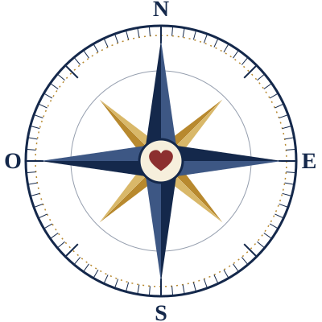
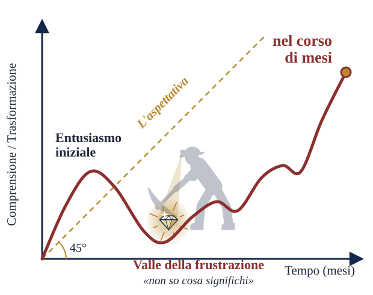

# Cartografia della Parola — Parte 1 (estratto per le slide dal vivo)

Copia di lavoro: solo «Testo della slide» e «Note per chi parla» di `cartografia-della-parola.md`
(Project «Bibbia - come leggerla»). La sorgente completa, con la verifica dottrinale, resta quella.
Se cambi il testo là, copialo qui (o passa il file completo a `make_slides.py`: legge lo stesso formato).

---

## Slide 1 — Titolo

### Testo della slide

<!-- layout: title -->

# Cartografia della Parola
## Guida pratica per studiare la Bibbia partendo da zero

> Un ecosistema di strumenti storici, teologici e pratici per orientarsi nel testo sacro senza perdersi

Basato su *Dei Verbum*, *Catechismo della Chiesa Cattolica*, San Tommaso d'Aquino e *Verbum Domini*

### Note per chi parla

*(2 minuti)*
- Apri con una domanda: *"Quante volte avete aperto la Bibbia con entusiasmo e l'avete richiusa dopo tre pagine del Levitico?"* Lascia qualche secondo di silenzio: quasi tutti si riconoscono.
- Spiega l'immagine: la bussola ha un cuore al centro. Studiamo la Bibbia non per accumulare nozioni, ma per arrivare al cuore di Dio. Lo riprenderemo nell'ultima slide.
- La "mappa" di stasera ha tre tappe: **perché** è faticoso (slide 2-3), **che cos'è** la Scrittura (slide 4-6), **come** leggerla (slide 7-12).

---

## Slide 2 — Non esistono traduttori automatici per la crescita spirituale

### Testo della slide

<!-- layout: cards; columns: 2; size: 28 -->

**L'illusione: la comodità della sintesi**
Affidarsi *unicamente* a commentari, podcast o riassunti altrui è come usare un'app di traduzione in un paese straniero: funziona per sopravvivere, ma impedisce di entrare davvero in contatto con la cultura del luogo.

**La realtà: l'immersione nel testo**
Lo studio chiede di lottare con il vocabolario e con il contesto. È un lavoro faticoso, ma è l'unica via per una trasformazione duratura e per scoprire il cuore dell'autore.

> «Abbiamo perso di vista il modo di leggere la Scrittura che avevano [i Padri]: una parola viva dal cuore di Dio.»
> — Mary Healy, biblista

> «L'ignoranza delle Scritture è ignoranza di Cristo»
> — San Girolamo, citato in *Dei Verbum* 25

### Note per chi parla

*(4 minuti)*
- Racconta un'esperienza personale: un passo che hai capito solo dopo averci "litigato" per giorni, e che poi ti ha cambiato. Il testimone convince più dell'argomento.
- Sottolinea la parola **unicamente**. Non stiamo dicendo "buttate i commentari": la Chiesa stessa raccomanda edizioni con note e sussidi approvati (*Dei Verbum* 25). Il problema è delegare *tutto*, senza mai aprire il testo.
- Domanda all'assemblea: *"Quanta della vostra conoscenza della Bibbia viene da letture dirette, e quanta da omelie, video o libri su di essa?"*
- **Chi è Mary Healy**: biblista, decana della Facoltà di Teologia e titolare della cattedra di Sacra Scrittura al Sacred Heart Major Seminary di Detroit; membro della Pontificia Commissione Biblica dal 2014. La frase è tratta dall'intervista «Toward Biblical Literacy» ([ZENIT, 2008](https://www.catholic.org/news/national/story.php?id=30547)). Originale: *"We have lost sight of how to read Scripture as they did — as a living word from the heart of God."* Il «loro» sono i Padri della Chiesa. Nella stessa intervista cita proprio San Girolamo, come fa questa slide.
- Altra frase possibile, dalla stessa intervista, se vuoi insistere sulla regolarità: *"There is a weariness and boredom with the Catholic faith that comes with not drinking deeply of the Word on a regular basis."* («C'è una stanchezza e una noia della fede cattolica che nasce dal non bere a fondo la Parola con regolarità.»)

---

## Slide 3 — La trasformazione è un lavoro lento: aspetta la Curva della Lotta

### Testo della slide

<!-- layout: split; size: 20 -->

**La Curva della Lotta**
- *Aspettativa*: una crescita costante a 45°.
- *Realtà*: entusiasmo iniziale → **valle della frustrazione** (testi difficili, "non so cosa significhi") → lenta risalita → frutti visibili **nel corso di mesi**.

Invece di cercare subito una via di fuga su internet per evitare il disagio del "non lo so", **siediti con il testo**. La frustrazione è solo apparente: come un minatore, scava con pazienza. Nella valle Dio ha nascosto un diamante.

*«È gloria di Dio nascondere le cose, è gloria dei re investigarle» (Prov 25,2).*
Come Giacobbe allo Iabbok, non lasciare andare finché non ricevi la benedizione (Gen 32,23-33).

### Note per chi parla

*(4 minuti)*
- Disegna la curva a mano su una lavagna se puoi: rende più dell'immagine.
- **Il minatore nella valle.** Nel grafico, proprio nel punto più basso, un minatore con il piccone scava e trova un diamante. La valle della frustrazione non è un vuoto: è il luogo dove Dio ha nascosto il tesoro. Leggi [Prov 25,2](https://www.bibbiaedu.it/CEI2008/at/Pr/25/): *«È gloria di Dio nascondere le cose, è gloria dei re investigarle»*. Dio non si nasconde per scoraggiarci, ma perché lo cerchiamo: la fatica del "non capisco" è una chiamata a scovare con pazienza le cose di Dio, e la ricompensa è grande.
- L'altra icona di questa slide è **Giacobbe che lotta tutta la notte** ([Gen 32,23-33](https://www.bibbiaedu.it/CEI2008/at/Gen/32/)): ne esce ferito all'anca ma benedetto, e con un nome nuovo. La lotta con la Parola non è un ostacolo alla relazione con Dio: è una forma della relazione.
- Rassicura: la valle della frustrazione non è un segno di fallimento, è una tappa normale. Chi molla lì perde il meglio, proprio quando stava per trovare il diamante.
- Precisa che non è solo fatica umana: è lo Spirito che fa crescere (1 Cor 3,6-7). Noi mettiamo la fedeltà, Lui il frutto.

---

## Slide 4 — Prima di leggere, calibra la bussola: cos'è la Scrittura?

### Testo della slide

<!-- layout: cards; columns: 2; size: 28 -->

**Autore divino: ispirazione e verità**
Dio parla agli uomini come ad amici per invitarli alla comunione con sé. La Scrittura insegna con certezza, fedelmente e senza errore la verità che Dio ha voluto consegnarci per la nostra salvezza.

**Autori umani: la condiscendenza divina**
Dio ha parlato per mezzo di uomini, alla maniera umana. Ha scelto persone nel pieno possesso delle loro facoltà, che hanno scritto come **veri autori**.

> Il lettore deve ricercare che cosa gli scrittori sacri (gli agiografi) volevano dire nel loro tempo e nei loro generi letterari — storici, profetici, poetici — per capire che cosa Dio ha voluto manifestare attraverso di loro.
> *(Dei Verbum 11-13)*

### Note per chi parla

*(5 minuti)*
- Usa l'analogia del Concilio stesso (DV 13): **come il Verbo si è fatto carne, così le parole di Dio si sono fatte linguaggio umano**. La Bibbia è "incarnata": 100% Parola di Dio e 100% parola umana. Se dimentichi una delle due metà sbagli strada.
- Due errori opposti da nominare:
  - **Solo umana**: "è un libro antico come tanti" → si perde la fede.
  - **Solo divina**: "è dettata parola per parola, non serve capire il contesto" → si cade nel fondamentalismo.
- Esempio concreto: i Salmi sono poesia, non cronaca. Il Vangelo di Luca è una narrazione ordinata (Lc 1,1-4). Un genere letterario va letto come tale.
- **Citazione di Mary Healy** ([ZENIT, 2008](https://www.catholic.org/news/national/story.php?id=30547)): *"…take full account of the twofold nature of Scripture as both divine and human, the Word of God in human words."* («…tener conto pienamente della duplice natura della Scrittura, divina e umana: la Parola di Dio in parole umane.») La frase è l'inizio di un periodo più lungo: citala con i puntini.

---

## Slide 5 — La Scrittura non è isolata: fa parte di un ecosistema vivo

### Testo della slide

<!-- layout: pillars; size: 24 -->

**Un solo deposito della fede**, affidato alla Chiesa, formato da:

| **Sacra Scrittura** | **Sacra Tradizione** |
|---|---|
| La Parola di Dio messa per iscritto per ispirazione dello Spirito Santo. | La predicazione apostolica viva, che progredisce nella Chiesa con l'assistenza dello Spirito. È la Tradizione che fa conoscere l'intero canone dei libri sacri. |

**Al servizio del deposito: il Magistero vivo**
L'ufficio affidato ai successori degli apostoli di interpretare autenticamente la Parola. **Non è superiore alla Parola, ma la serve.**

> Scrittura, Tradizione e Magistero sono così uniti che nessuno dei tre sussiste senza gli altri. Scrittura e Tradizione vanno accolte con pari riverenza. *(Dei Verbum 9-10)*

### Note per chi parla

*(5 minuti)*
- Immagine utile: **Scrittura e Tradizione sono le due colonne dell'arco**; il Magistero è il **custode** che vigila sull'arco e ne garantisce l'integrità, non una terza colonna.
- Ricorda il canone: senza la Tradizione non sapremmo nemmeno *quali* libri fanno parte della Bibbia. La lista non è scritta in nessun libro biblico.
- Detto patristico citato dal Catechismo (CCC 113): la Scrittura è scritta nel cuore della Chiesa prima che sui supporti materiali. Leggere la Bibbia "da soli contro tutti" è leggerla fuori dal suo luogo naturale.
- Rassicura chi teme il Magistero come "controllo": DV 10 dice che il Magistero *ascolta, custodisce ed espone* la Parola, e da essa attinge tutto ciò che propone.

---

## Slide 6 — I due Testamenti si leggono allo specchio

### Testo della slide

<!-- layout: cards; columns: 3; size: 28 -->

**L'Antico Testamento**
Prepara, annuncia profeticamente e significa con diverse figure la venuta del Redentore. Mostra la pedagogia divina e conserva un valore perenne.

**L'unità inseparabile**
Il Nuovo è nascosto nell'Antico, e l'Antico è svelato nel Nuovo. I libri dell'Antico Testamento acquistano e manifestano il loro pieno significato nel Nuovo, che essi a loro volta illuminano e spiegano.

**Il Nuovo Testamento**
La pienezza dei tempi: Cristo stabilisce il Regno. I Vangeli hanno una superiorità meritata perché sono la testimonianza principale sulla vita e la dottrina del Verbo incarnato.

### Note per chi parla

*(4 minuti)*
- La frase "il Nuovo è nascosto nell'Antico..." è di **Sant'Agostino**, ripresa da DV 16 e CCC 129.
- Esempio da mostrare: **i discepoli di Emmaus** ([Lc 24,27](https://www.bibbiaedu.it/CEI2008/nt/Lc/24/)): Gesù spiega "in tutte le Scritture ciò che si riferiva a lui", cominciando da Mosè. È Gesù stesso a insegnarci a leggere l'Antico Testamento alla luce di Cristo.
- Attenzione al rischio opposto: l'Antico non è un "vecchio scaffale da archiviare". La Chiesa ha sempre respinto l'idea di scartarlo (CCC 123, contro Marcione).

---

## Slide 7 — Quattro guide per estrarre il significato

### Testo della slide

<!-- layout: cards; columns: 2; size: 23 -->

**Il rigore logico — San Tommaso d'Aquino**
Risolve il problema di un testo con più significati: tutti i sensi poggiano sul senso letterale, l'unico da cui si possono trarre argomenti. Così si evitano interpretazioni fantasiose.

**La profondità storica — Henri de Lubac**
Il gesuita (poi cardinale) che nel Novecento ha riportato alla luce i quattro sensi, mostrando che sono l'architettura stessa del pensiero cristiano che unisce i due Testamenti.

**La sintesi autorevole — Catechismo della Chiesa Cattolica**
Struttura i quattro sensi (nn. 115-119) come una mappa accessibile per la vita di fede quotidiana.

**L'applicazione poetica — Dante Alighieri**
Mostra come questi sensi sono stati applicati anche alla letteratura (Lettera a Cangrande).

> **L'ultima parola spetta alla Chiesa**: tutto ciò che riguarda l'interpretazione della Scrittura è sottoposto in ultima istanza al giudizio della Chiesa. *(Dei Verbum 12; CCC 119)*

### Note per chi parla

*(4 minuti)*
- Presenta i quattro come **compagni di viaggio**, non come autorità allo stesso livello: Tommaso è Dottore della Chiesa, il Catechismo è un testo magisteriale, de Lubac è un grande teologo, Dante è un poeta.
- Su de Lubac: la sua opera è *Esegesi medievale. I quattro sensi della Scrittura* (originale francese 1959-1964). Fu creato cardinale da Giovanni Paolo II.
- Su Tommaso: la quaestio di riferimento è **Summa Theologiae I, q. 1, a. 10**. Un bel dettaglio per l'assemblea: per Tommaso, quando la Bibbia parla del "braccio di Dio", il senso letterale **non** è che Dio abbia un braccio, ma la sua potenza operante. Il senso letterale è ciò che l'autore *intende*, anche con una metafora.

---

## Slide 8 — L'iceberg dell'esegesi: i quattro sensi della Scrittura

### Testo della slide

<!-- layout: depth; size: 23 -->

**1. Sopra la superficie — il senso letterale**
La base indispensabile, storica e linguistica. *Che cosa intendeva dire l'autore sacro, nel suo genere letterario?* Tutti i sensi della Scrittura si fondano su quello letterale (San Tommaso, citato in CCC 116).

**2. Sotto la superficie — il senso allegorico**
La connessione con Cristo. *Come questo evento prefigura Gesù o la Chiesa?* Esempio del Catechismo: la traversata del Mar Rosso è segno della vittoria di Cristo e del Battesimo.

**3. Acque profonde — il senso morale**
L'agire del cristiano. *Che cosa insegna questo testo per la mia condotta e la mia conversione?*

**4. Il fondo dell'oceano — il senso anagogico**
La destinazione finale. *Come questo testo mi orienta verso l'eternità e la Gerusalemme celeste?*

> *La lettera insegna i fatti, l'allegoria che cosa credere, il senso morale che cosa fare, l'anagogia dove tendere.* — distico medievale, CCC 118

### Note per chi parla

*(6 minuti)*
- Insegna il **distico medievale** (CCC 118): è facile da memorizzare e riassume tutta la slide. Puoi farlo ripetere all'assemblea.
- Fai un esempio completo con il **Mar Rosso** ([Es 14](https://www.bibbiaedu.it/CEI2008/at/Es/14/)):
  - *letterale*: Israele attraversa il mare e viene liberato dall'Egitto;
  - *allegorico*: Cristo vince la morte; il Battesimo ci fa passare dalla schiavitù alla libertà (1 Cor 10,1-2);
  - *morale*: anch'io sono chiamato a "uscire" dalle mie schiavitù;
  - *anagogico*: il passaggio definitivo alla terra promessa del Cielo.
- Attenzione all'immagine dell'iceberg: non deve far pensare che il letterale sia "superficiale" nel senso di poco importante. È la **fondazione**: senza la punta che si vede, non sapremmo nemmeno dove sta il resto.

---

## Slide 9 — Caso studio: applicare i 4 sensi con Dante Alighieri

### Testo della slide

<!-- layout: steps; size: 25 -->

**Salmo 114 (113 nella Vulgata): «Quando Israele uscì dall'Egitto...»**

1. **Letterale — il fatto storicamente accaduto**: l'uscita dei figli d'Israele dall'Egitto, al tempo di Mosè.
2. **Allegorico — il fatto nascosto**: la nostra redenzione compiuta da Cristo.
3. **Morale — la vita interiore**: la conversione dell'anima, che passa dal lutto e dalla miseria del peccato allo stato di grazia.
4. **Anagogico — l'orizzonte eterno**: l'uscita dell'anima santa dalla schiavitù di questa corruzione verso la libertà della gloria eterna.

### Note per chi parla

*(4 minuti)*
- Mostra il salmo: [Sal 114 su BibbiaEdu](https://www.bibbiaedu.it/CEI2008/at/Sal/114/). Spiega che Dante lo chiama Salmo 113 perché segue la numerazione della Vulgata latina; nelle Bibbie italiane di oggi è il **114**.
- Curiosità che colpisce sempre: è lo stesso salmo che Dante fa cantare alle anime che arrivano al Purgatorio sulla barca dell'angelo (*Purgatorio* II, 46). Per lui quel canto *è* il senso anagogico in azione: anime che "escono dall'Egitto" verso la libertà.
- Esercizio veloce: proponi all'assemblea un versetto breve (per esempio [Gv 2,1-11](https://www.bibbiaedu.it/CEI2008/nt/Gv/2/), le nozze di Cana) e chiedi di trovare insieme i quattro sensi in 3 minuti.

---

## Slide 10 — La bussola per i momenti di stallo

### Testo della slide

<!-- layout: compass; size: 22 -->

Quando la lettura diventa difficile, non saltare subito ai commentari.
Invoca lo Spirito Santo, **Autore principale** della Scrittura, che ha ispirato gli agiografi perché scrivessero come **veri autori** (DV 11). Poi fai queste quattro domande al testo:

- **N — Che cosa mi rivela questo testo su Dio e sul suo carattere?** *(senso letterale)*
- **E — Come si manifesta qui Cristo e la speranza del Vangelo?** *(senso allegorico)*
- **S — Come mi chiama a cambiare mente e vita, lasciando l'uomo vecchio per seguire e obbedire alla Parola?** *(senso morale)*
- **O — Verso dove mi conduce? Come mi orienta al Cielo?** *(senso anagogico)*

> **Leggi *nella* Chiesa**: con attenzione all'unità di tutta la Scrittura, alla Tradizione viva e all'analogia della fede. *(Dei Verbum 12; CCC 112-114)*

### Note per chi parla

*(5 minuti)*
- Fai notare che le quattro domande della bussola corrispondono ai **quattro sensi** della slide 8: è lo stesso metodo, reso pratico per la lettura personale.
- Collega alla **lectio divina** che Benedetto XVI descrive in *Verbum Domini* 87: *lectio* (che cosa dice il testo), *meditatio* (che cosa dice a me), *oratio* (che cosa rispondo a Dio), *contemplatio* (che sguardo mi dona), *actio* (che cosa cambia nella mia vita).
- Testimonianza: racconta un "momento di stallo" in cui una di queste domande ti ha sbloccato.
- **Mary Healy sulla lettura nella Chiesa** ([ZENIT, 2008](https://www.catholic.org/news/national/story.php?id=30547)): la Scrittura va interpretata "nello stesso spirito in cui è stata scritta" (*Dei Verbum* 12), il che richiede fede e preghiera e *"fidelity to the community of faith in which the Scriptures were formed, the Church"* («fedeltà alla comunità di fede in cui le Scritture sono nate, la Chiesa»).
- **Mary Healy sulla domanda che sta sotto tutte le altre** (stessa intervista): *"…what does Scripture reveal about Jesus Christ… who he is, what he did and said, what pleases him, and how we come to know him?"* («…che cosa rivela la Scrittura su Gesù Cristo: chi è, che cosa ha fatto e detto, che cosa gli è gradito e come arriviamo a conoscerlo?»). È un buon modo di riassumere le quattro domande.
- Bilancia il "non saltare subito ai commentari": il punto non è fare a meno della Chiesa, ma dare prima spazio all'ascolto personale. Poi le note della Bibbia CEI e i buoni commentari sono preziosi (DV 25).

---

## Slide 11 — L'equipaggiamento digitale: scegli lo strumento giusto

### Testo della slide

<!-- layout: table; size: 25 -->

| | **[BibbiaEdu (CEI)](https://www.bibbiaedu.it/)** | **[La Bibbia su Vatican.va](https://www.vatican.va/archive/ITA0001/_INDEX.HTM)** | **[Verbum](https://verbum.com/)** |
|---|---|---|---|
| **Obiettivo** | Testo ufficiale e confronto con gli originali | Ricerca per parola chiave | Esegesi approfondita e lingue originali |
| **Uso migliore** | Leggere la CEI 2008 con le sue note; confrontarla con CEI 1974, Interconfessionale, ebraico, greco e Nova Vulgata | Concordanze: seguire una parola (es. *alleanza*) dalla Genesi all'Apocalisse | Lessici, commentari cattolici, strumenti di analisi del greco e dell'ebraico |
| **Costo** | Gratuito | Gratuito | A pagamento, risorse quasi tutte in inglese |

### Note per chi parla

*(5 minuti, ideale con dimostrazione dal vivo)*
- **BibbiaEdu** — mostra due cose:
  1. un capitolo con le note: [Gv 5 (CEI 2008)](https://www.bibbiaedu.it/CEI2008/nt/Gv/5/);
  2. il confronto con l'originale: [Sal 114 affiancato al testo ebraico](https://www.bibbiaedu.it/CEI2008/at/Sal/114/?compareto=EBRAICO) oppure [Gv 5 affiancato al greco](https://www.bibbiaedu.it/CEI2008/nt/Gv/5/?compareto=GRECO_NT).

  C'è anche l'app ufficiale "Bibbia CEI" per smartphone.
- **Vatican.va** — la Bibbia sul sito vaticano è la **CEI 1974** in formato IntraText, con **liste e concordanze di tutte le parole**: è lo strumento giusto per seguire un tema attraverso tutta la Scrittura. Sullo stesso sito ci sono i documenti del Magistero (DV, CCC, *Verbum Domini*).
- **Verbum** — è la versione cattolica di Logos Bible Software. È potente ma a pagamento e quasi solo in inglese: consiglialo a chi vuole davvero approfondire.
- **Alternativa gratuita per le parole originali**: [Blue Letter Bible](https://www.blueletterbible.org/), con numeri Strong e lessici di greco ed ebraico. È un sito di area protestante: va bene per la lingua, meno per l'interpretazione.

---

## Slide 12 — I segnali di pericolo: come capire se stiamo sbagliando strada

### Testo della slide

<!-- layout: table; columns: 2; size: 22 -->

La Bibbia è sacra, ma non è Dio. La fede cristiana non è una "religione del Libro", ma della Parola viva, il Verbo incarnato (CCC 108). Sostituire la relazione con Dio con lo studio delle sue pagine porta a derive malate.

| **La deriva** | **La via sana** |
|---|---|
| Usare la Bibbia come destinazione finale ([Gv 5,39-40](https://www.bibbiaedu.it/CEI2008/nt/Gv/5/)) | Usarla come guida verso il Dio vivo (CCC 108) |
| Usare i versetti come un'arma, con durezza | Leggere con carità: senza amore non sono nulla ([1 Cor 13,2](https://www.bibbiaedu.it/CEI2008/nt/1Cor/13/)) |
| Condannare gli altri per avere ragione | Portare il frutto dello Spirito ([Gal 5,22-23](https://www.bibbiaedu.it/CEI2008/nt/Gal/5/)); dai frutti si riconosce l'albero ([Mt 7,20](https://www.bibbiaedu.it/CEI2008/nt/Mt/7/)) |
| Pensare che Dio abbia smesso di parlare 2000 anni fa | Dio non cessa di parlare alla sua Chiesa e lo Spirito guida alla verità tutta intera ([Gv 16,13](https://www.bibbiaedu.it/CEI2008/nt/Gv/16/); DV 8) — **senza nuove rivelazioni pubbliche** (DV 4; CCC 66-67) |
| Pretendere di capire tutto e subito | Fidarsi di Dio nel Mistero: la fede è certa, anche quando non vede tutto ([Eb 11,1](https://www.bibbiaedu.it/CEI2008/nt/Eb/11/); CCC 157) |

### Note per chi parla

*(5 minuti)*
- Leggi [Gv 5,39-40](https://www.bibbiaedu.it/CEI2008/nt/Gv/5/): Gesù dice a chi scruta le Scritture che esse rendono testimonianza a Lui, ma che non vogliono venire a Lui per avere la vita. Si può conoscere la Bibbia a memoria e non conoscere Gesù.
- Sul quarto punto (Dio parla ancora) sii molto chiaro, soprattutto in un contesto carismatico:
  - **sì**: Dio continua a parlare oggi, attraverso la Scrittura letta nella Chiesa, la liturgia, la preghiera, i carismi e anche ispirazioni personali;
  - **ma**: la Rivelazione pubblica è completa in Cristo. Le rivelazioni private, profezie comprese, non aggiungono nulla al deposito della fede: aiutano a viverlo meglio in un dato tempo, e vanno discernute alla luce della Scrittura e della Chiesa (CCC 67).
- Una frase di Mary Healy che aiuta sul quarto punto ([Sunday Examiner, Hong Kong, 28 giugno 2024](https://examiner.org.hk/2024/06/28/dont-be-afraid-to-share-about-god-speaker-urges/news/hongkong/)): la Bibbia non è *"just an ancient artifact that tells us some interesting things"* ma *"the living word of God today"* («non un semplice reperto antico che ci dice cose interessanti, ma la parola viva di Dio oggi»). Sono due estratti dello stesso periodo: verifica il testo sulla pagina.
- Sul quinto punto: il Mistero non è vaghezza. La fede cattolica ha certezze solide (CCC 157). Il pericolo non è la certezza, ma la pretesa di dominare Dio con la propria comprensione.

---

## Slide 13 — Il fine ultimo della Scrittura non è l'informazione, ma la comunione

### Testo della slide

<!-- layout: closing -->

# Il fine ultimo della Scrittura non è l'informazione, ma la comunione.

> La lettura della Sacra Scrittura deve essere sempre accompagnata dalla preghiera, perché si stabilisca un vero dialogo tra Dio e l'uomo.
> «Quando preghiamo, parliamo con lui; lui ascoltiamo, quando leggiamo gli oracoli divini.»
> — Sant'Ambrogio, citato in *Dei Verbum* 25

**Inizia oggi.** Abbraccia il mistero, sopporta la frustrazione del momento e osserva che cosa Dio farà con la tua obbedienza nel corso dei prossimi mesi.
Lo studio fedele modella silenziosamente il cuore a immagine di Cristo.

*«Lampada per i miei passi è la tua parola, luce sul mio cammino» (Sal 119,105)*

### Note per chi parla

*(3 minuti)*
- Torna al cuore della bussola della slide 1: ecco dove punta l'ago. Lo scopo della Rivelazione è la **comunione** con Dio: è la prima frase della *Dei Verbum*, che cita [1 Gv 1,2-3](https://www.bibbiaedu.it/CEI2008/nt/1Gv/1/).
- Proposta concreta per chiudere: un piccolo impegno per la settimana. Per esempio 10 minuti al giorno con il Vangelo della Messa, usando le quattro domande della slide 10.
- Concludi con un momento di preghiera: invoca lo Spirito Santo e leggete insieme il versetto finale, o un brano breve in *lectio*.
- Frase kerygmatica di chiusura: *Ne vale la pena. Egli è fedele.*
- **Mary Healy** ([National Catholic Register/CNA, 28 gennaio 2025](https://www.ncregister.com/cna/american-theologian-promoted-by-pope-francis-calls-for-focus-on-scripture-evangelization)) indica come priorità che i cattolici *"fall in love with Scripture and come to know it as a living word from God"* («si innamorino della Scrittura e la conoscano come parola viva di Dio»). Nella stessa intervista: *"The Holy Spirit makes both the Scriptures and the sacraments come alive."* («Lo Spirito Santo rende vive sia le Scritture sia i sacramenti.») Sono estratti di frasi più lunghe: verifica il testo sulla pagina.

---

## Slide 14 — Le fonti: per continuare il viaggio

### Testo della slide

<!-- layout: sources; size: 22 -->

**Magistero della Chiesa**

| Autore | Testo | Dove si usa | Link |
|---|---|---|---|
| Concilio Vaticano II | *Dei Verbum*, Costituzione dogmatica sulla divina Rivelazione (1965) | slide 2, 4, 5, 6, 7, 10, 12, 13 | [vatican.va](https://www.vatican.va/archive/hist_councils/ii_vatican_council/documents/vat-ii_const_19651118_dei-verbum_it.html) |
| Catechismo della Chiesa Cattolica | nn. 101-141, *La Sacra Scrittura* | slide 4-8, 10, 12 | [vatican.va](https://www.vatican.va/archive/catechism_it/p1s1c2a3_it.htm) |
| Catechismo della Chiesa Cattolica | nn. 66-67 (Rivelazione e rivelazioni private) e n. 157 (certezza della fede) — dall'indice generale | slide 12 | [indice](https://www.vatican.va/archive/catechism_it/index_it.htm) |
| Benedetto XVI | *Verbum Domini*, Esortazione apostolica postsinodale (2010), nn. 37 e 86-87 | slide 8, 10 | [vatican.va](https://www.vatican.va/content/benedict-xvi/it/apost_exhortations/documents/hf_ben-xvi_exh_20100930_verbum-domini.html) |
| Pontificia Commissione Biblica | *L'interpretazione della Bibbia nella Chiesa* (1993) | slide 8 | [vatican.va](https://www.vatican.va/roman_curia/congregations/cfaith/pcb_documents/rc_con_cfaith_doc_19930415_interpretazione_it.html) |

<!-- pagebreak -->

**Padri, Dottori e autori**

| Autore | Testo | Dove si usa | Link |
|---|---|---|---|
| San Tommaso d'Aquino | *Summa Theologiae* I, q. 1, a. 10 — Se la Sacra Scrittura abbia più sensi | slide 7, 8 | [testo in inglese](https://ccel.org/ccel/aquinas/summa.FP_Q1_A10.html) |
| Henri de Lubac | *Esegesi medievale. I quattro sensi della Scrittura* (ed. or. *Exégèse médiévale*, 1959-1964) | slide 7 | — (volume a stampa) |
| Dante Alighieri | *Epistola XIII a Cangrande della Scala* | slide 7, 9 | [traduzione inglese](https://faculty.georgetown.edu/jod/cangrande.english.html) |
| San Girolamo | *Commento a Isaia*, Prologo — citato in *Dei Verbum* 25 | slide 2 | [Dei Verbum](https://www.vatican.va/archive/hist_councils/ii_vatican_council/documents/vat-ii_const_19651118_dei-verbum_it.html) |
| Sant'Ambrogio | *De officiis ministrorum* I, 20, 88 — citato in *Dei Verbum* 25 | slide 13 | [Dei Verbum](https://www.vatican.va/archive/hist_councils/ii_vatican_council/documents/vat-ii_const_19651118_dei-verbum_it.html) |

<!-- pagebreak -->

**Mary Healy, biblista** (Pontificia Commissione Biblica)

| Autore | Testo | Dove si usa | Link |
|---|---|---|---|
| Mary Healy | Intervista «Toward Biblical Literacy» (ZENIT, 2008) | slide 2 (testo); note 4, 10 | [catholic.org](https://www.catholic.org/news/national/story.php?id=30547) |
| Mary Healy | Intervista al National Catholic Register/CNA (28 gennaio 2025) | note 13 | [ncregister.com](https://www.ncregister.com/cna/american-theologian-promoted-by-pope-francis-calls-for-focus-on-scripture-evangelization) |
| Mary Healy | «Don't be afraid to share about God», *Sunday Examiner*, Hong Kong (28 giugno 2024) | note 12 | [examiner.org.hk](https://examiner.org.hk/2024/06/28/dont-be-afraid-to-share-about-god-speaker-urges/news/hongkong/) |

<!-- pagebreak -->

**Strumenti per leggere e studiare**

| Strumento | Che cosa offre | Link |
|---|---|---|
| BibbiaEdu (CEI) | Bibbia CEI 2008 e 1974 con note, Interconfessionale, ebraico, greco, Nova Vulgata, confronto tra testi | [bibbiaedu.it](https://www.bibbiaedu.it/) |
| La Sacra Bibbia su vatican.va | Testo CEI 1974 con liste e concordanze di tutte le parole | [vatican.va](https://www.vatican.va/archive/ITA0001/_INDEX.HTM) |
| Verbum | Biblioteca e software cattolico di studio biblico (a pagamento, in inglese) | [verbum.com](https://verbum.com/) |
| Blue Letter Bible | Lessici di greco ed ebraico con numeri Strong (gratuito, area protestante) | [blueletterbible.org](https://www.blueletterbible.org/) |

### Note per chi parla

*(1-2 minuti, oppure da lasciare proiettata durante le domande)*
- Non leggere la tabella: basta dire che tutte le fonti sono raggiungibili online e che il materiale verrà condiviso dopo l'incontro.
- Suggerisci un ordine di lettura per chi vuole approfondire: prima i **nn. 101-141 del Catechismo** (brevi e chiari), poi la ***Dei Verbum*** (è corta: si legge in mezz'ora), poi la ***Verbum Domini*** per la lectio divina.
- Sui telefoni dei partecipanti i link sono cliccabili.

---

## Slide 15 — Le risorse: gli indirizzi per esteso

### Testo della slide

<!-- layout: urls; size: 20 -->

**Magistero della Chiesa**

| Risorsa | Indirizzo |
|---|---|
| *Dei Verbum* | [https://www.vatican.va/archive/hist_councils/ii_vatican_council/documents/vat-ii_const_19651118_dei-verbum_it.html](https://www.vatican.va/archive/hist_councils/ii_vatican_council/documents/vat-ii_const_19651118_dei-verbum_it.html) |
| Catechismo, nn. 101-141 | [https://www.vatican.va/archive/catechism_it/p1s1c2a3_it.htm](https://www.vatican.va/archive/catechism_it/p1s1c2a3_it.htm) |
| Catechismo, indice | [https://www.vatican.va/archive/catechism_it/index_it.htm](https://www.vatican.va/archive/catechism_it/index_it.htm) |
| *Verbum Domini* | [https://www.vatican.va/content/benedict-xvi/it/apost_exhortations/documents/hf_ben-xvi_exh_20100930_verbum-domini.html](https://www.vatican.va/content/benedict-xvi/it/apost_exhortations/documents/hf_ben-xvi_exh_20100930_verbum-domini.html) |
| Pontificia Commissione Biblica (1993) | [https://www.vatican.va/roman_curia/congregations/cfaith/pcb_documents/rc_con_cfaith_doc_19930415_interpretazione_it.html](https://www.vatican.va/roman_curia/congregations/cfaith/pcb_documents/rc_con_cfaith_doc_19930415_interpretazione_it.html) |

<!-- pagebreak -->

**Strumenti per leggere la Bibbia**

| Risorsa | Indirizzo |
|---|---|
| BibbiaEdu (CEI) | [https://www.bibbiaedu.it/](https://www.bibbiaedu.it/) |
| Bibbia CEI 1974 su vatican.va | [https://www.vatican.va/archive/ITA0001/_INDEX.HTM](https://www.vatican.va/archive/ITA0001/_INDEX.HTM) |
| Verbum | [https://verbum.com/](https://verbum.com/) |
| Blue Letter Bible | [https://www.blueletterbible.org/](https://www.blueletterbible.org/) |

**Testi dei Padri e dei Dottori** (traduzioni inglesi)

| Risorsa | Indirizzo |
|---|---|
| San Tommaso, *Summa* I, q. 1, a. 10 | [https://ccel.org/ccel/aquinas/summa.FP_Q1_A10.html](https://ccel.org/ccel/aquinas/summa.FP_Q1_A10.html) |
| Dante, *Epistola XIII* | [https://faculty.georgetown.edu/jod/cangrande.english.html](https://faculty.georgetown.edu/jod/cangrande.english.html) |

### Note per chi parla

*(da lasciare proiettata durante le domande)*
- Non leggere gli indirizzi: i link sono cliccabili sui telefoni e nel PDF condiviso dopo l'incontro.
- Suggerisci da dove partire: il Catechismo (nn. 101-141), poi la *Dei Verbum*, poi la *Verbum Domini*.

---

## Slide 16 — Quiz 1

### Testo della slide

<!-- layout: quiz -->

# Quiz 1: mettiti alla prova!
## Cartografia della Parola · 12 domande

Inquadra il codice con il telefono, scrivi il tuo nome e rispondi. Alla fine i primi tre salgono sul podio.

[https://lucapaone76.github.io/quiz-live-cartografia-bibbia/vote.html?quiz=1](https://lucapaone76.github.io/quiz-live-cartografia-bibbia/vote.html?quiz=1)

### Note per chi parla

*(lasciare proiettata mentre le persone entrano nel quiz)*
- Sui telefoni compare il pulsante «Entra nel quiz 1»: chi segue le slide ha già il nome, non deve riscriverlo.
- Apri il pannello del quiz (pulsante qui sotto, stesso PIN). Aspetta che quasi tutti siano entrati, poi premi «Avvia il quiz». Sono 12 domande, circa 12-15 minuti.
- Dopo ogni risposta giusta leggi la riga di spiegazione che compare sullo schermo.
